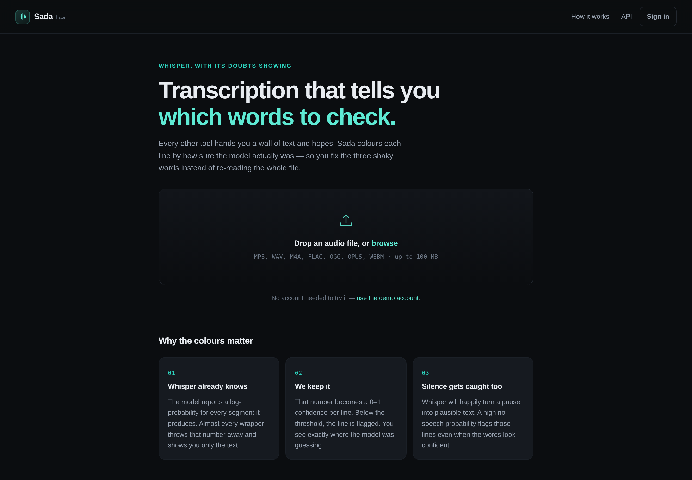
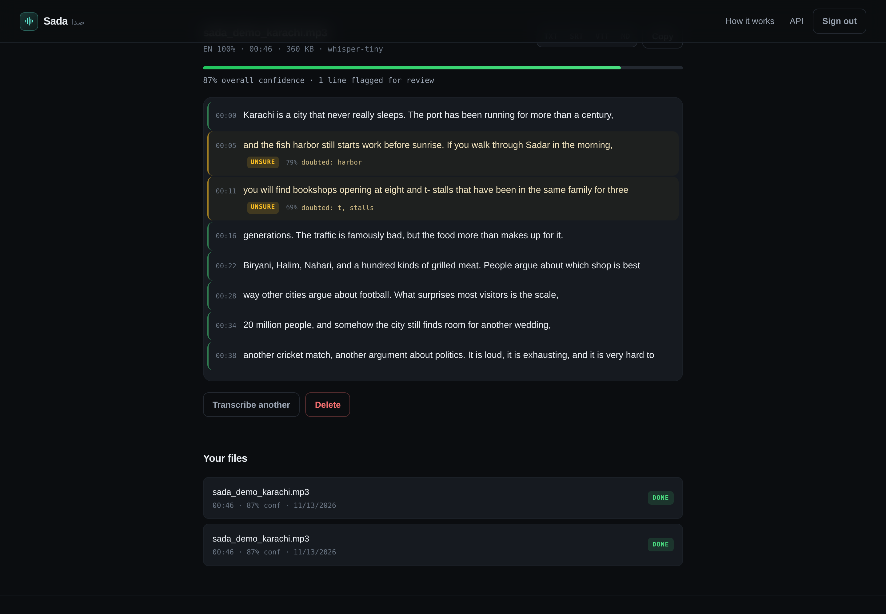
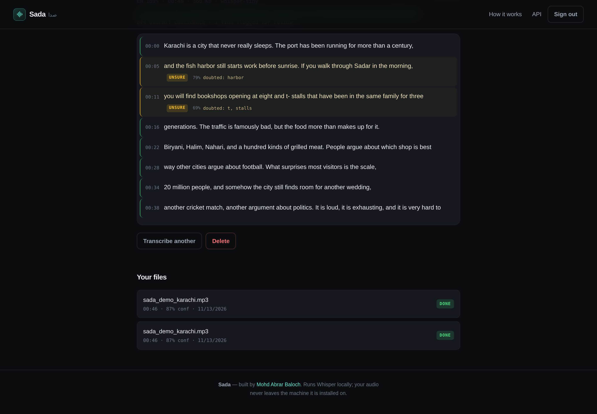
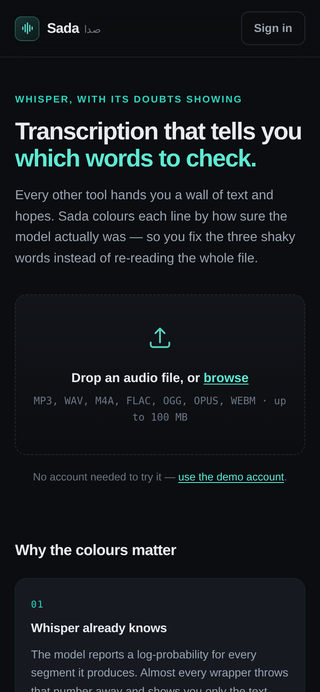

# Sada · صدا

**Speech transcription that tells you which words it is unsure about.**

[](https://www.python.org/)
[](https://fastapi.tiangolo.com/)
[](#tests)
[](https://github.com/astral-sh/ruff)
[](LICENSE)

---

Every transcription tool hands you a wall of text and hopes for the best.
Whisper is very good, but it is not perfect — and it fails in predictable
places: names, accents, technical vocabulary, and silence, which it will
cheerfully turn into plausible sentences.

The information needed to flag those failures already exists. Whisper emits a
probability for every token. Almost every wrapper throws it away.

Sada keeps it, and shows it to you.



## What it actually does

Upload an audio file. Get a transcript where every line is coloured by how
sure the model was, and flagged lines name the exact words it doubted.

```
00:11  you will find bookshops opening at eight and t- stalls that have been
       in the same family for three generations.
       [CHECK] 69%   doubted: t, stalls
```

The audio said "tea stalls". Whisper heard "t- stalls" and was not confident.
Sada flagged that line and named the two tokens. Every other line in the file
was clean and stayed green.


## Features

- **Per-line confidence** from word-level probabilities, not the segment
  average — see [why that matters](#why-word-probabilities) below
- **Named doubtful words** — not just "low confidence", but *which* words
- **Silence detection** — flags lines where the model suspected there was no
  speech, which is where Whisper invents text
- **Four export formats** — TXT (reflowed into paragraphs), SRT, VTT, and
  Markdown with ⚠ markers for review workflows
- **Runs locally** — your audio never leaves the machine it is installed on
- **JWT auth** with bcrypt, per-user isolation, 404-not-403 on other people's
  files
- **Streaming upload** with progress, size cap enforced mid-stream
- **Mobile-first UI** — vanilla JS, no build step, no framework
- **81 tests**, all offline, whole suite under a second

## Screenshots

| Landing | Transcript |
|---|---|
|  |  |

| History | Mobile |
|---|---|
|  |  |

## Why word probabilities

This is the design decision the whole project rests on, and it came from
measuring rather than assuming.

faster-whisper reports `avg_logprob` per segment — but it is averaged over the
entire 30-second decode window. Consecutive segments inside one window come
back with **identical** values to many decimal places:

```
 0.00- 5.36  lp=-0.157482
 5.36-10.96  lp=-0.157482
10.96-15.52  lp=-0.157482
15.52-20.56  lp=-0.157482
```

A per-line confidence built on that would be decoration, not a feature — every
line in a window would show the same number. Word probabilities are per-token
and genuinely differ, and they catch real errors:

```
11.08  avg=0.887  min=0.233  low=[' t', ' stalls']   ← "tea stalls" misheard
 5.46  avg=0.933  min=0.446  low=[' harbor']
```

So segment confidence is `0.7 × mean + 0.3 × worst`. One badly-wrong word
pulls the line down without destroying it. A line is flagged if its confidence
is low, if its worst word is under 0.35, or if `no_speech_prob` is above 0.6.

## Quick start

```bash
git clone https://github.com/mohdabrarbaloch-arch/day-20-sada.git
cd day-20-sada

python -m venv .venv && source .venv/bin/activate
pip install -e ".[dev]"

cp .env.example .env
python -c "import secrets; print('JWT_SECRET=' + secrets.token_urlsafe(48))" >> .env

python -m app.seed
uvicorn app.main:app --reload
```

Open <http://127.0.0.1:8000> and click **use the demo account**.

You need `ffmpeg` on the PATH. The first transcription downloads the model
(~75 MB for `tiny`) — once, not at startup.

### Docker

```bash
cp .env.example .env      # put a real JWT_SECRET in it
docker compose up --build
```

Brings up the app plus Postgres 16. `WHISPER_MODEL=base docker compose up` to
use a better model without rebuilding.

## Installation guide

| Step | Command | Notes |
|---|---|---|
| 1. Clone | `git clone ...` | |
| 2. Virtualenv | `python -m venv .venv && source .venv/bin/activate` | Python 3.11+ |
| 3. Install | `pip install -e ".[dev]"` | Pulls faster-whisper, FastAPI, SQLAlchemy |
| 4. ffmpeg | `apt install ffmpeg` / `brew install ffmpeg` | Required for decoding |
| 5. Config | `cp .env.example .env` | Set `JWT_SECRET` |
| 6. Seed | `python -m app.seed` | Creates the demo account |
| 7. Run | `uvicorn app.main:app --reload` | <http://127.0.0.1:8000> |

Full details, model comparison and troubleshooting: [`docs/setup.md`](docs/setup.md).

## Choosing a model

| Model | Size | CPU speed | Quality |
|---|---|---|---|
| `tiny` | 75 MB | ~1× realtime | Fine for clear English |
| `base` | 145 MB | ~0.6× realtime | Noticeably better on names |
| `small` | 480 MB | ~0.3× realtime | The practical default |
| `large-v3` | 3 GB | needs a GPU | Best |

Set `WHISPER_MODEL` in `.env`. On a GPU also set `WHISPER_DEVICE=cuda` and
`WHISPER_COMPUTE_TYPE=float16`.

## Tests

```bash
pytest              # 81 tests, offline, < 1s
ruff check .        # clean
ruff format --check # clean
```

The suite never downloads a model and never touches the network — the engine
is only imported inside the function that loads it, so route tests run without
Whisper installed at all.

## API

```bash
curl -X POST localhost:8000/api/jobs \
  -H "Authorization: Bearer $TOKEN" \
  -F "file=@talk.mp3"

curl "localhost:8000/api/jobs/$ID/export?fmt=srt" \
  -H "Authorization: Bearer $TOKEN" -o talk.srt
```

Full reference: [`docs/api.md`](docs/api.md) · live OpenAPI at `/api/docs`.

## Architecture

See [`ARCHITECTURE.md`](ARCHITECTURE.md) for the system diagram, data flow,
and scaling notes — including where this breaks first (background tasks in the
web process) and what to do about it.

## Live demo

Not deployed. There is no `VERCEL_TOKEN` in the build environment, and Vercel
is a poor fit for this app anyway: its filesystem is read-only apart from
`/tmp`, which does not survive between invocations, so the SQLite database
would vanish. The `Dockerfile` and `docker-compose.yml` are committed and
`docker compose up --build` has it running in about a minute.

## Known limitations

- **Background tasks run in the web process.** A long file blocks a worker and
  a restart loses in-flight jobs. Needs Celery/RQ before real traffic.
- **Rate limiting is per-process.** Set `RATELIMIT_STORAGE_URI=redis://...`
  before running multiple workers.
- **`create_all()` instead of migrations.** Fine for one deploy; add Alembic
  once there is data worth keeping.
- **Uploads go to local disk.** Multi-instance deployments need object
  storage.
- **`tiny` mangles proper nouns.** That is what the confidence score is for —
  but `base` or `small` is the better default for real work.

## License

MIT — see [LICENSE](LICENSE).

Built by [Mohd Abrar Baloch](https://github.com/mohdabrarbaloch-arch) as
Day 20 of a 30-day build challenge.
